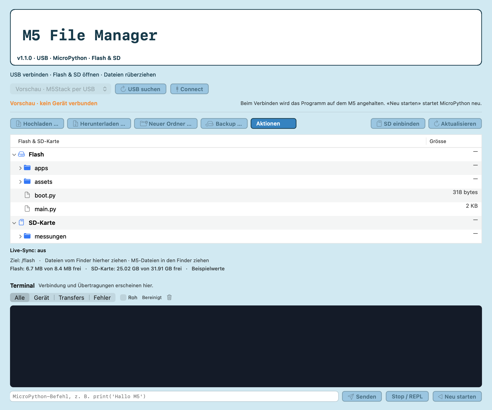

# M5 File Manager für macOS

Native Mac-App zum Durchsuchen und Übertragen von Dateien auf M5Stack-Geräten mit MicroPython oder UIFlow2. Flash und SD öffnen, Dateien mit dem Finder kopieren, Texte bearbeiten und Terminalausgabe lesen.

**Sprache wechseln:** Menü **Language / Sprache → Deutsch / English**. Die Wahl wird gespeichert. Offene Editortexte bleiben erhalten. Dateinamen, Dateiinhalte und Geräteausgaben werden nicht übersetzt. Native Systemdialoge können der macOS-Sprache folgen.

[English guide](README.md) · [Technik](docs/ARCHITECTURE.md) · [Tests](Tests/README.md) · [MIT-Lizenz](LICENSE)



## Voraussetzungen

- macOS 14 oder neuer, Apple Silicon oder Intel.
- USB-Datenkabel und erreichbares MicroPython-Raw-REPL. Ein gefundener USB-Port bestätigt noch keine passende Firmware.
- Andere serielle Monitore und Firmware-Werkzeuge müssen den Port freigeben.
- **Öffentliche Vorschau:** Der lokale Build ist ad hoc signiert und noch nicht von Apple notarisiert. Die reibungslose Installation einer Developer-ID-Veröffentlichung steht noch aus.

Zum Ausführen braucht es weder Python noch Node oder Docker. Zum Bauen werden Apples Command Line Tools benötigt, für die Tests zusätzlich Python 3.

## Verwendung

1. [Universal-Vorschau-ZIP laden](https://github.com/LakeGriffin85/m5-file-manager/releases/download/v1.1.0-preview.1/M5-File-Manager-1.1.0-preview-universal.zip), entpacken und **M5 File Manager.app** öffnen oder die App selbst bauen. Auf der [Release-Seite](https://github.com/LakeGriffin85/m5-file-manager/releases/tag/v1.1.0-preview.1) stehen Prüfsumme und Vorschau-Grenzen.
2. Board anschliessen, Port wählen und **Connect** drücken. Es wird nie automatisch verbunden.
3. Flash oder SD aufklappen. Vom Finder ins Fenster ziehen lädt hoch; vom Dateibaum in den Finder ziehen lädt herunter. Die Knöpfe bieten dieselben Aktionen.
4. Textdatei doppelklicken und bearbeiten. **Auf M5 speichern** überträgt Änderungen nach lokaler Sicherung des bisherigen Inhalts.
5. **Neu starten** führt die regulären MicroPython-Startdateien neu aus.

**Dateizugriff hält das laufende Python-Programm an. Disconnect setzt es nicht fort.** Ein Neustart beginnt neu. Danach das Board erst fertig starten lassen; eine erneute Aktualisierung unterbricht Python wieder.

## Funktionen und Grenzen

- Dateien und Ordner kopieren; Upload mit Base64, CRC32 vor dem Schreiben und nach dem Rücklesen, temporärer Datei und Wiederherstellungsversuch beim Ersetzen.
- UTF-8-Editor bis 1 MiB, lokale Originalsicherungen und Konfliktprüfung. SHA-256 vergleicht Inhalte, keine Änderungszeitpunkte.
- CSV als Tabelle bis 5000 Zeilen / 128 Spalten, JSON formatiert, PNG/JPEG/BMP bis 8 MiB / 24 Megapixel. Vorschauen ändern die Dateien nicht.
- Vorschau-Lesen mit 4-KiB-Base64-Blöcken, Fortschritt und protokollierter Lesezeit.
- Dateisicherungen, Umbenennen und Verschieben innerhalb eines Speichers. Vor dem Löschen ist die lokale Sicherung standardmässig aktiv.
- Bewusst aktivierbarer Live-Sync mit festen Mac-/M5-Ordnern, Konfliktprüfung, Rücklesen und automatischem Neustart. Lokale Löschungen löschen nichts auf dem M5. Maximal 128 Dateien, je 1 MiB, insgesamt 8 MiB; keine Symlinks.
- SD manuell einbinden mit den geprüften UIFlow2-Profilen für **Core2 und Original-Cardputer**. Bereits eingebundene Speicher bleiben auch auf anderen Geräten nutzbar. Keine geratenen Pins, Formatierung oder Firmware-Installation.
- Python-Dateien starten, Autostart ausdrücklich konfigurieren, Terminal filtern. ⌘U lädt hoch, ⌘R startet neu, ⌘S speichert im Editor.

Stromausfälle während abschliessender Umbenennungen können manuelle Wiederherstellung erfordern. Eine abgebrochene Ordneraktion kann bereits abgeschlossene Dateien enthalten. Die Tests simulieren ein Board; die konkrete Hardware und Firmware brauchen einen eigenen Test.

## Einstellungen und Sicherungen

Eigene Einstellungsdomäne: `org.m5filemanager.desktop`.

- Originalsicherungen: `~/Library/Application Support/M5 File Manager/Safety Backups`
- Löschsicherungen: `~/Library/Application Support/M5 File Manager/Deletion Backups`

Andere Löschziele unter **Aktionen → Ordner für Lösch-Sicherungen wählen …** auswählen. Ein nicht erreichbares Ziel wird nicht stillschweigend ersetzt. Die App benötigt keine Konten, Telemetrie oder Netzwerkdienste. Vor dem Teilen von Logs oder Sicherungen deren Inhalt prüfen.

## Bauen

Im Repository-Ordner:

```sh
./scripts/build.sh
```

Für Apple Silicon und Intel gemeinsam:

```sh
UNIVERSAL=1 ./scripts/build.sh
```

Vorhandene Builds werden nicht überschrieben. Die Ausgabe liegt unter `dist/M5 File Manager.app`. Es wird nichts installiert oder hochgeladen. `./scripts/package.sh` erstellt danach ein lokales Vorschau-ZIP mit SHA-256-Prüfsumme.

Unabhängiges Community-Werkzeug, kein offizielles M5Stack-Produkt. Lizenz: **MIT**.
