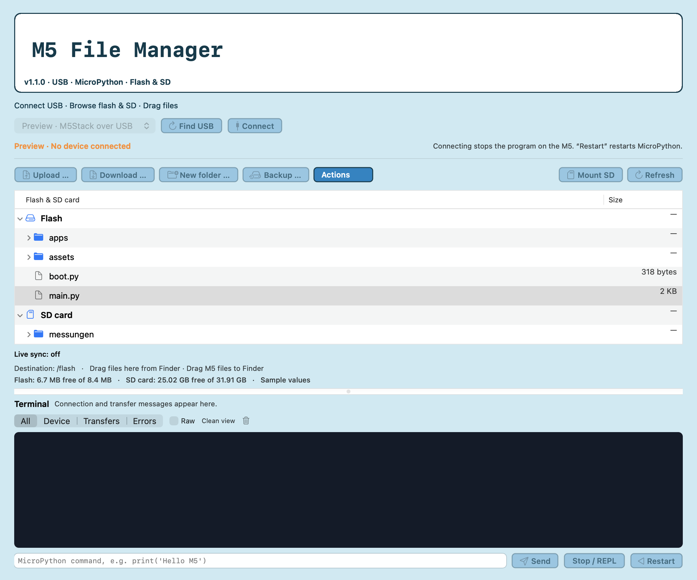

# M5 File Manager for macOS

A native macOS utility for browsing and transferring files on M5Stack devices running MicroPython or UIFlow2. Connect over USB, browse flash and SD, drag files to or from Finder, edit text, and inspect terminal output.

**English / Deutsch:** select **Language / Sprache → English / Deutsch** in the menu bar. The choice is saved. Open editors retain unsaved text. Device output, file names and file contents are kept in their original language. Native system dialogs may follow the macOS language.

[Deutsche Anleitung](README.de.md) · [Architecture](docs/ARCHITECTURE.md) · [Testing](Tests/README.md) · [License](LICENSE)



## Requirements and status

- macOS 14 or later; source builds support Apple Silicon and Intel.
- A USB data cable and reachable MicroPython raw REPL. A detected USB port alone does not establish firmware compatibility.
- Only one application can own the serial port. Close serial monitors, web terminals and firmware tools before connecting.
- This is a **public preview**. The local build uses an ad-hoc signature and is **not Apple-notarized**. It does not yet have the download-and-open experience of a Developer ID release.
- No Python, Node or Docker is needed to run the built app. Building needs Apple's Command Line Tools; tests also need Python 3.

## Quick start

1. Build the app as described below and open `dist/M5 File Manager.app`.
2. Connect the board, select its USB port, and click **Connect**. There is no automatic connection.
3. Expand flash or SD. Drag from Finder to upload, or drag from the file tree to Finder to download. Buttons offer the same operations.
4. Double-click `.py`, `.txt`, `.json` or `.csv` to open the editor. Save to the M5 explicitly; the previous file is backed up locally first.
5. Use **Restart** when you want MicroPython's normal startup files to run again.

**File operations stop the running Python program. Disconnect does not resume it.** Restart runs the startup files anew; it does not continue from the interrupted instruction. After a restart, let the board finish booting before refreshing. Refresh itself interrupts Python again.

## Features

- Flash and mounted-SD browser; file and folder transfers with Finder drag and drop.
- Uploads use Base64 blocks, CRC32 checks before writing and after reading back, temporary staging, and rollback support when replacing a file.
- UTF-8 editor up to 1 MiB, local safety copies, revision conflict checks, and SHA-256 sync indicators.
- CSV tables (5,000 rows / 128 columns), formatted JSON, and PNG/JPEG/BMP previews (8 MiB / 24 MP). The view does not rewrite the file.
- Bounded preview reads use 4 KiB Base64 blocks with progress and a transfer timing entry.
- Explicit file backups, rename, moves within one storage volume, and deletion with a local backup enabled by default.
- Optional live sync: select a Mac folder and M5 destination, confirm the initial transfer, then transfer stable changes with readback and an automatic restart. Conflicts stop the watcher. Local deletion never deletes M5 files. Limits: 128 files, 1 MiB each, 8 MiB total; no symlinks.
- Manual SD mounting for the tested UIFlow2 **Core2 and original Cardputer profiles**. Other boards can use already mounted storage. The app does not guess pins, format storage, or flash firmware.
- Explicit Python run and autostart tools; filtered terminal output; ⌘U upload, ⌘R restart and ⌘S save in the editor.

Transfer staging is not a power-loss-safe filesystem transaction. An interruption during final renames may leave helper files that need manual recovery. For folder operations, a failure can leave some earlier files completed; the app reports acknowledged and uncertain outcomes separately.

## Local data

The app uses its own settings domain, `org.m5filemanager.desktop`, independently of other builds.

- Safety copies: `~/Library/Application Support/M5 File Manager/Safety Backups`
- Default deletion backups: `~/Library/Application Support/M5 File Manager/Deletion Backups`
- Choose another deletion-backup folder under **Actions → Choose deletion backup folder …**. An unavailable saved destination stays explicit; there is no silent fallback before deletion.

No accounts, telemetry, cloud storage or network requests are required by the app. Files, backups and terminal logs can contain information from your board; review them before sharing them in an issue.

## Build

From this repository's root:

```sh
./scripts/build.sh
```

Build for both architectures:

```sh
UNIVERSAL=1 ./scripts/build.sh
```

The output is `dist/M5 File Manager.app`. An existing output is never overwritten; move it aside before rebuilding. The build signs locally and does not install or upload anything. An optional `SIGNING_IDENTITY` environment variable enables Developer ID signing; notarization is a separate release step.

To make a local preview archive after building:

```sh
./scripts/package.sh
```

See [publication notes](docs/PUBLICATION.md) for the remaining distribution checks. Current regression tests simulate a device with a pseudo-terminal; they are not a substitute for testing your own board and firmware.

## License and project scope

[MIT](LICENSE). This is an independent community tool, not an official M5Stack product. M5Stack, MicroPython, UIFlow and macOS names describe compatibility and belong to their respective owners.
